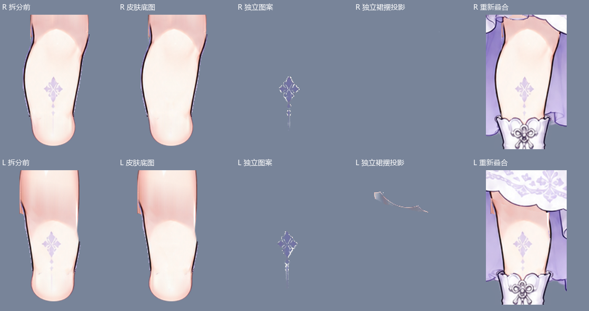

# 小汐基础图层 · 最新审查快照

版本：R192 · 2026-10-27。**待审查素材，不是定稿或可直接运行的 Cubism 模型。**

本文件夹集中维护最新图层；后续更新沿用此路径，通过 Git 历史比较变化。正式桌宠资源不受影响。

## 查看与编辑

- `workbench/layers.json`：图层顺序、分组、可见性和关节参考位置。
- `workbench/parts/`：全部原尺寸透明 PNG 图层。
- `foundation-review.ora`：可编辑 OpenRaster 图层快照，可在支持 ORA 的绘画软件中打开；不是 PSD、CMO3 或 MOC3。
- `neutral.png`：当前中性拼装预览。
- `leg-three-part-review.png`：腿部、图案、阴影分离对比。
- `VISUAL-REVIEW.json`：R192 的计算检查记录，视觉验收仍待进行。
- `checksums.json`：文件 SHA-256，供后续检查更新。

PNG 均为 1086 × 1448，保留透明度与原始画布定位。清单从底层到顶层绘制，必须遵守 visible 字段。ORA 为保持遮挡顺序采用平铺图层，名称标注所属分组；不要直接按组重排。

## 本轮变化与限制

保留此前的头脸、发耳、颈部、衣袖和手腕修复，新增腿部皮肤、紫色图案与裙摆投影分离。图案跟随腿部；阴影记录跟随裙摆及腿部裁剪关系。

裁剪字段只是编辑意图，尚未接入运行时；没有自动光照或自动投影实现。R192 对 R191 的中性拼装最大通道误差为 3，超过 2 的像素为 2 个，这不代表与最初原图完全一致或动作验收通过。

仍需检查：图案提取的局部高透明度遮罩、阴影中的不透明像素、耳根完整性、手腕接缝、腿靴和裙摆交界、翼尾独立性以及运动后露底。当前快照不替换稳定素材。

## 预览

